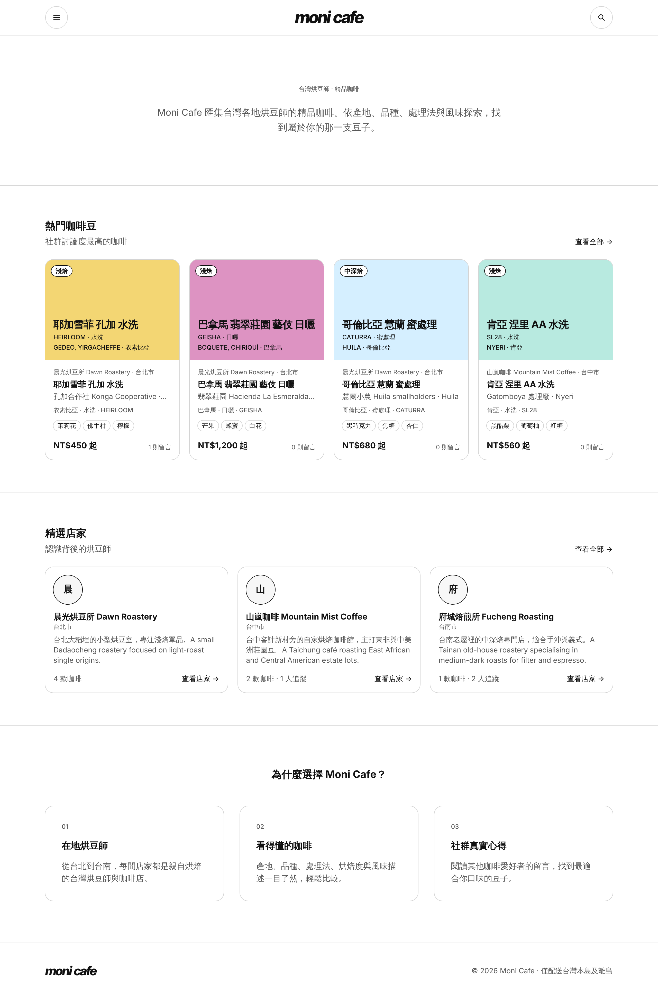
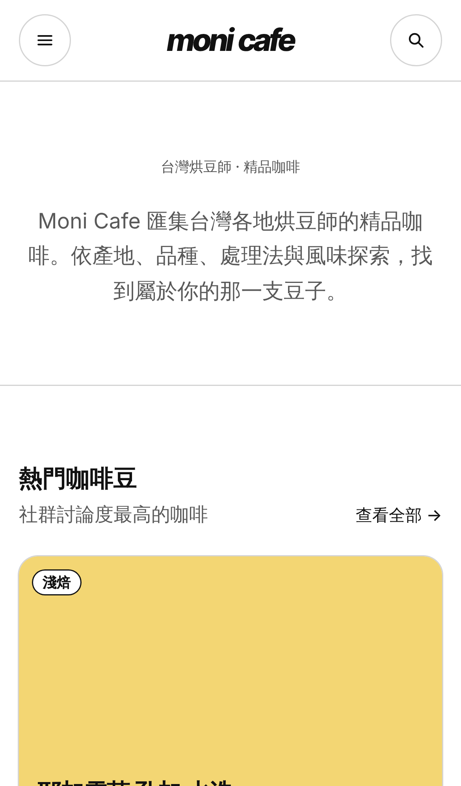
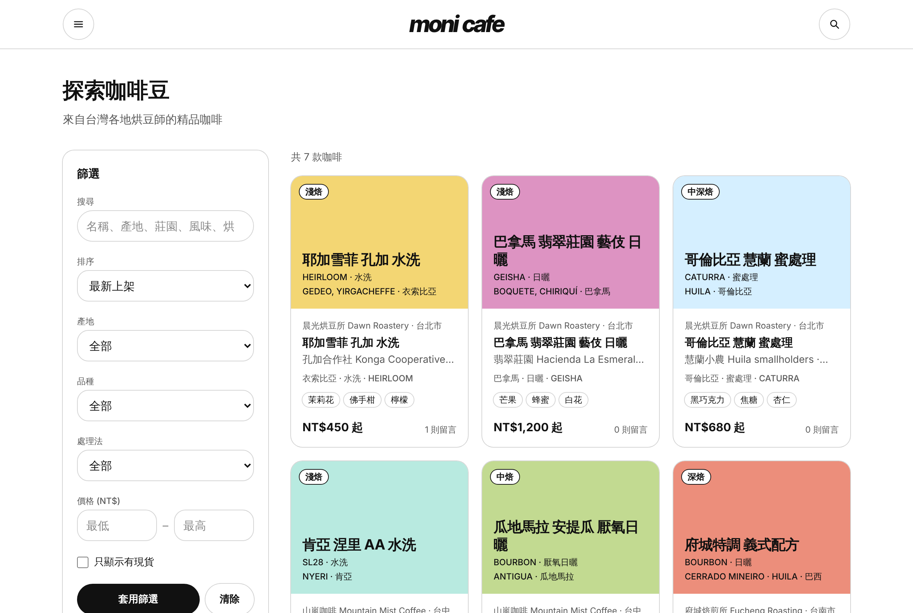

# moni cafe

**A marketplace for Taiwan's specialty-coffee roasters.** Every roaster gets a clean, bilingual storefront; coffee
drinkers browse beans by origin, variety and process, read what other people thought, and follow the roasters they
like. Buying on the site (cart, ECPay payment, convenience-store pickup) comes in Stage 2.

台灣精品咖啡烘豆師的線上市集：每間烘豆所都有自己的雙語店面，咖啡愛好者可以依產地、品種、處理法探索豆子、閱讀留言、追蹤喜歡的店家。

<p align="center">
  
  &nbsp;
  
</p>

## What it does today (Stage 1: discovery)

**For coffee drinkers**
- Browse every coffee on `/coffees`, filtered by origin, variety, process, price and stock, with keyword search and sort.
- Coffee pages show the producer, region, altitude, harvest, roast, flavour notes, options and NT$ per 100 g, with
  photos or a soft colour tile, "you may also like" from other shops, and comments.
- Roaster storefronts at `/shops/<slug>`, arranged by the roaster, with a sold-out archive. `/map` shows where they are.
- Accounts: save coffees, follow roasters, comment (roasters get a 店家 badge), report abuse, delete your account.

**For roasters**
- A seller dashboard to open a shop, add coffees with options, upload photos, reorder the lineup, publish or unpublish,
  and read comments.

**For admins**
- `/admin` lists reports, lets admins suspend users and shops, and shows an append-only audit log.

Everything is in Traditional Chinese first, with English one click away. Prices are whole New Taiwan Dollars; shops ship
within Taiwan only.

<p align="center">
  
</p>

## Run it locally

You need Docker with Compose v2.

```bash
cp .env.example .env
docker compose up --build
```

Open **http://localhost**. The first start creates the database, runs the migrations and loads three demo roasters
(Taipei, Taichung, Tainan) with their coffees. The demo sellers can't sign in, so register your own account and choose
"Open a shop" in the menu to try the seller side.

To make yourself an admin:

```bash
docker compose exec backend /app/admin grant you@example.com
```

Optional services start only when asked: `--profile cache` (Redis), `--profile search` (Meilisearch, Stage 3) and
`--profile prod` (the nightly backup job).

## How it's built

```
browser ──► nginx :80 ──┬─► frontend   Next.js 16 (App Router, React 19, Tailwind CSS 4)
                        │     └─ /api/auth/*  holds the refresh token in an httpOnly cookie
                        ├─► backend    Go 1.27 · chi · gqlgen GraphQL · pgx   (/graphql, /health)
                        └─► /media/    S3-compatible image store (SeaweedFS in development)
backend ──► PostgreSQL 17
```

| Folder | What's in it |
|---|---|
| [`backend/`](backend) | GraphQL API (`graph/`), SQL (`internal/store`), auth, rate limits, storage, metrics, `cmd/admin` |
| [`frontend/`](frontend) | Pages (`app/`), components (`components/ui/` is the design system), helpers (`lib/`), tests |
| [`migrations/`](migrations) | Plain SQL, applied in order by `scripts/migrate.sh` on every start |
| [`nginx/`](nginx) | The only public entry point: gzip, rate limits and the `/media/` proxy |
| [`scripts/`](scripts) | Migrations, demo seed, `smoke.sh` (end-to-end checks), backup and restore |
| [`docs/`](docs) | Roadmap, deploy and monitoring guide, backup runbook, session log |

Some decisions shape the code throughout:
- Prices are integers in NT$.
- IDs are UUIDs.
- Seller text is never rendered as HTML.
- Sellers can't put contact details or outside links in their text.
- The look is white and black only.

The reasons behind each of these are in [`PROJECT_BRIEF.md`](PROJECT_BRIEF.md).

## Checks

```bash
cd backend  && gofmt -l . && go vet ./... && go test ./...
cd frontend && npm ci && npx tsc --noEmit && npm run lint && npm test && npm run build
docker compose up --build -d && ./scripts/smoke.sh
```

The backend's integration tests run when `TEST_DATABASE_URL` points at a migrated database. CI runs all of the
checks above on every pull request:
- backend and frontend builds and tests;
- the full Compose stack with `smoke.sh` and a backup-and-restore drill;
- `govulncheck` and `npm audit`.

## Project status and roadmap

| Stage | Goal | |
|---|---|---|
| **1 — Discovery** | Browse, accounts, comments, seller dashboard, images, moderation | Built; hosting is next |
| 2 — Transactions | Cart, orders, ECPay (綠界) payment, convenience-store pickup / home delivery | Waiting on business decisions |
| 3 — Growth | Search (Meilisearch), seller analytics, collections, email | — |

- **Planning:** the work queue and the owner's open decisions are [GitHub Issues](../../issues), labelled `slice` and
  `question`.
- **Current state:** [`PROJECT_BRIEF.md`](PROJECT_BRIEF.md).
- **What comes next and why:** [`docs/ROADMAP.md`](docs/ROADMAP.md).
- **Contributors and agents:** start with [`CLAUDE.md`](CLAUDE.md). It has the rules and the verification steps.
